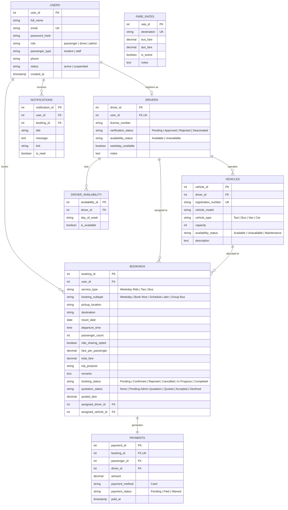

# 🚌 Sherubtse Campus Ride – Campus Transport Booking System
> **Sherubtse College, Kanglung, Bhutan**  
> Technology Stack: **Node.js + Express.js + EJS + PostgreSQL (MVC Architecture)**

---

## 📖 1. Project Overview & Objectives

**Campus Ride** is a full-featured campus transportation and booking platform designed for the students, faculty, and administrative staff of **Sherubtse College, Kanglung, Bhutan**.

The system streamlines campus transit across three core transportation services:
1. **Available Weekday Rides**: Fixed-rate shuttle (Nu. 100) between student hostels and academic classroom blocks (Monday to Friday).
2. **Book a Taxi**: Immediate pickup (*Book Now*) or scheduled transit (*Schedule for Later*) to any of the **20 Dzongkhags of Bhutan** or local destinations, featuring whole-vehicle hire or automatic shared-fare splitting. Unlisted destinations support custom Admin fare quotations.
3. **Request a Bus**: Group transportation and academic field tours using the college bus fleet, handled via an official quotation and vehicle/driver allocation workflow.

A centralized **Admin Operations Console** manages verified drivers, campus vehicles, booking manifests, the 20-Dzongkhag tariff schedule, custom quotations, and cash payment reconciliations.

---

## 🎨 2. Visual Design & Theme Palette

The application implements a clean, mobile-responsive layout styled according to the official Sherubtse Campus Ride design system:
- **Royal Blue (`#2563EB`)**: Primary branding, action buttons, active tabs.
- **Orange / Gold (`#F97316`)**: Accent badges, urgent callouts, highlights.
- **White (`#FFFFFF`) & Light Grey (`#F3F4F6`)**: Background cards, clean contrast.
- **Dark Navy (`#172554`)**: Top navigation bar, headers, typography.
- **Soft Blue (`#DBEAFE`)**: Informational alerts, table highlights.

---

## 👥 3. User Roles & Capabilities

| Role | Classification | Primary Functions |
|---|---|---|
| **Passenger** | Student or Faculty/Staff | • Register with student/staff designation<br>• Request Weekday rides (Hostel ⇄ Classroom)<br>• Book taxis (Book Now / Schedule Later, whole or split fare)<br>• Request Campus Bus for group tours<br>• View live fare estimates & accept/decline quotations<br>• Track booking history & cash payment status |
| **Driver** | Verified Campus Driver | • Log in to Driver Console<br>• Toggle general availability & weekday ride availability<br>• Accept / reject incoming ride requests<br>• View assigned college bus trips<br>• Update trip lifecycle (`In Progress` → `Completed`)<br>• Record received cash payments from passengers |
| **Admin** | Transport Administrator | • Verify, approve, or deactivate campus drivers<br>• Manage fleet vehicles (Campus Buses, Taxis, Cars)<br>• Monitor and manage all 3 transport services<br>• Provide custom fare quotations for unlisted destinations<br>• Assign drivers and buses without scheduling conflicts<br>• Manage fare chart for all 20 Dzongkhags<br>• Mark payments as Paid or Waived (for official college trips)<br>• Analytics dashboard with real-time stats |

---

## 🚗 4. Transportation Services

### 4.1 Available Weekday Rides
- **Routes**: *Hostel to Classroom* and *Classroom to Hostel*.
- **Operating Days**: Monday through Friday only.
- **Fare**: Strictly fixed at **Nu. 100** per ride.
- **Workflow**: Passenger selects route, pickup spot, and an available verified driver. The selected driver receives instant notification to accept or reject the booking.

### 4.2 Book a Taxi
- **Modes**:
  - **Book Now**: Immediate departure; eligible verified drivers are notified and the first driver to accept receives the assignment.
  - **Schedule for Later**: Specify future date and time; system verifies driver and vehicle availability to avoid scheduling overlaps.
- **Fare Calculation**: Whole taxi hire vs. Shared Taxi (fare automatically divided equally among 2 to 4 passengers).
- **Custom Quotations**: For unlisted destinations, passengers submit a custom quote request; the Admin sets the price, and the passenger can accept or decline before confirmation.

### 4.3 Request a Bus
- **Purpose**: Class group excursions, department research trips, student club tours, and official college events (5 to 60 passengers).
- **Workflow**:
  1. Passenger submits trip details (destination, date, time, passenger count, purpose).
  2. Status is set to `Pending` (`Pending Admin Quotation`).
  3. Admin reviews requirements and inputs the official fare quotation.
  4. Passenger reviews and **Accepts** or **Declines** the quote.
  5. Upon acceptance, Admin assigns an available campus bus and heavy-vehicle licensed driver.
  6. Trip becomes `Confirmed` and appears on the assigned driver's manifest.

---

## 💰 5. Fare Chart (All 20 Dzongkhags + Local Routes)

The system includes an Admin-managed fare table from Sherubtse College (Kanglung) to all 20 Dzongkhags of Bhutan:

| Destination | Bus Fare (Nu./pax) | Taxi Fare (Nu./hire) | Shared Taxi (4 Pax Est.) |
|---|---:|---:|---:|
| **Trashigang** | 200.00 | 500.00 | 125.00 |
| **Mongar** | 300.00 | 2,600.00 | 650.00 |
| **Lhuentse** | 450.00 | 4,400.00 | 1,100.00 |
| **Pemagatshel** | 400.00 | 3,500.00 | 875.00 |
| **Samdrup Jongkhar** | 470.00 | 4,600.00 | 1,150.00 |
| **Trashiyangtse** | 300.00 | 1,900.00 | 475.00 |
| **Zhemgang** | 750.00 | 9,500.00 | 2,375.00 |
| **Bumthang** | 700.00 | 7,500.00 | 1,875.00 |
| **Trongsa** | 850.00 | 9,500.00 | 2,375.00 |
| **Sarpang** | 1,100.00 | 13,500.00 | 3,375.00 |
| **Tsirang** | 1,050.00 | 14,000.00 | 3,500.00 |
| **Dagana** | 1,200.00 | 15,000.00 | 3,750.00 |
| **Chhukha** | 1,400.00 | 17,500.00 | 4,375.00 |
| **Samtse** | 1,500.00 | 19,000.00 | 4,750.00 |
| **Wangdue Phodrang** | 1,100.00 | 14,000.00 | 3,500.00 |
| **Punakha** | 1,150.00 | 14,500.00 | 3,625.00 |
| **Gasa** | 1,300.00 | 16,000.00 | 4,000.00 |
| **Thimphu** | 1,250.00 | 16,000.00 | 4,000.00 |
| **Paro** | 1,400.00 | 17,500.00 | 4,375.00 |
| **Haa** | 1,500.00 | 19,000.00 | 4,750.00 |
| **Hostel to Classroom** | 100.00 | 100.00 | 100.00 |
| **Classroom to Hostel** | 100.00 | 100.00 | 100.00 |
| **Sherubtse to Rangjung** | 350.00 | 800.00 | 200.00 |

*Note: All prices are calculated on the server and frozen with the booking record to guarantee price integrity.*

---

## 💵 6. Cash Payment System

- Passengers settle their fares in cash upon reaching their destination.
- Drivers record received payments directly via their Driver Console (`Pending` → `Paid`).
- Official institutional study trips or university-sponsored travel can be marked as `Waived` by the Admin.
- **Payment status is decoupled from trip status**: A booking can reach `Completed` status while cash payment remains `Pending` until confirmed by the driver.

---

## 🗄 7. PostgreSQL Database Schema (MVC)



---

## 🏗 8. Directory & MVC Architecture

```text
campus-ride/
├── config/
│   └── database.js               # Dual PostgreSQL connection pool + resilient in-memory fallback
├── controllers/
│   ├── adminController.js        # Admin ops: verification, bookings, bus assignment, tariffs, payments
│   ├── authController.js         # Session-based auth, student/staff registration, profile update
│   ├── bookingController.js      # Weekday rides, taxi booking, bus requests, quotes & payments
│   ├── driverController.js       # Availability toggles, incoming requests, trip lifecycle, cash records
│   ├── notificationController.js # Mark notifications as read
│   └── publicController.js       # Public views: Home, Services, Fare Chart, About, Contact
├── middleware/
│   ├── authMiddleware.js         # Session check & local variables population
│   └── roleMiddleware.js         # Role guards (isAdmin, isDriver, isPassenger)
├── models/
│   ├── bookingModel.js           # Bookings, conflict detection, quote acceptance, status updates
│   ├── driverModel.js            # Driver verification, availability lookups
│   ├── fareRateModel.js          # Authoritative server-side pricing & 20-Dzongkhag tariff CRUD
│   ├── notificationModel.js      # Alert dispatch and inbox retrieval
│   ├── paymentModel.js           # Decoupled cash payment recording & waiver handling
│   ├── userModel.js              # User auth, student/staff records, status toggles
│   └── vehicleModel.js           # Fleet management (Buses, Taxis, Cars)
├── public/
│   ├── css/style.css             # Theme stylesheet (Royal Blue, Orange, Navy palette)
│   └── js/script.js              # Client interactions & demo account autofill
├── routes/
│   ├── adminRoutes.js            # /admin/*
│   ├── authRoutes.js             # /login, /register, /profile, /logout
│   ├── bookingRoutes.js          # /weekday-rides, /book-taxi, /book-bus, /my-bookings, /payments
│   ├── driverRoutes.js           # /driver/*
│   ├── notificationRoutes.js     # /notifications
│   └── publicRoutes.js           # /, /services, /fare-chart, /about, /contact
├── sql/
│   ├── schema.sql                # Complete PostgreSQL table definitions & relational indexes
│   └── seed.sql                  # 20 Dzongkhag rates, local campus routes, default users & fleet
├── views/
│   ├── admin/                    # Admin dashboard, fleet, drivers, bookings, bus requests, tariffs
│   ├── auth/                     # Login, register (student/staff), profile
│   ├── driver/                   # Driver console, incoming requests, trips, assigned buses, cash
│   ├── partials/                 # Header, navbar, footer, alerts
│   ├── public/                   # Home, about, services, 20-Dzongkhag fare chart, contact
│   ├── student/                  # Passenger console, weekday booking, taxi booking, bus booking
│   ├── 404.ejs & 500.ejs         # Error handling pages
├── scripts/
│   ├── initDatabase.js           # Database migration & seed script
│   └── testSystem.js             # Automated 33-step verification test suite
├── app.js                        # Express application configuration
├── server.js                     # HTTP server startup & database health check
├── package.json
└── .env
```

---

## 🚀 9. Setup & Running Instructions

### Prerequisites
- **Node.js**: v18.0.0 or higher
- **PostgreSQL**: (Optional for local testing; the system includes a zero-dependency in-memory mock fallback that allows full functionality right out of the box!)

### Step 1: Install Dependencies
```bash
npm install
```

### Step 2: Configure Environment Variables
Verify or adjust `.env` as required:
```ini
PORT=3000
NODE_ENV=development
SESSION_SECRET=campus_ride_super_secure_secret_key_2026

# PostgreSQL Database Configuration
DB_HOST=127.0.0.1
DB_PORT=5432
DB_USER=postgres
DB_PASSWORD=postgres
DB_NAME=campus_ride_db
```

### Step 3: Initialize Database (PostgreSQL)
If connecting to a live PostgreSQL server:
```bash
npm run db:init
```

### Step 4: Run System Tests
Verify that all 33 tests across all 3 services pass:
```bash
npm test
```

### Step 5: Start Application
```bash
npm start
```
Open your browser at: **`http://localhost:3000`**

---

## 🔑 10. Pre-Configured Test Accounts

| Role | Email | Password | Access Scope |
|---|---|---|---|
| **Admin** | `admin@sherubtse.edu.bt` | `Admin@123` | Full Admin Operations Console, Fare Rates, Fleet, Bookings |
| **Driver (Taxi)** | `driver.ugyen@sherubtse.edu.bt` | `Driver@123` | Driver Console, Weekday Rides, Taxi Requests, Cash Records |
| **Driver (Bus)** | `driver.tashi@sherubtse.edu.bt` | `Driver@123` | Driver Console, Heavy Vehicle Campus Bus Trips |
| **Passenger (Student)** | `sonam@sherubtse.edu.bt` | `Student@123` | Weekday Rides, Taxi Booking, Bus Requests, Cash Payments |
| **Passenger (Staff)** | `karma.staff@sherubtse.edu.bt` | `Staff@123` | Faculty Transit, Institutional Bus Bookings |

*(Quick-login buttons are also provided directly on the Sign-in page for instant testing).*
